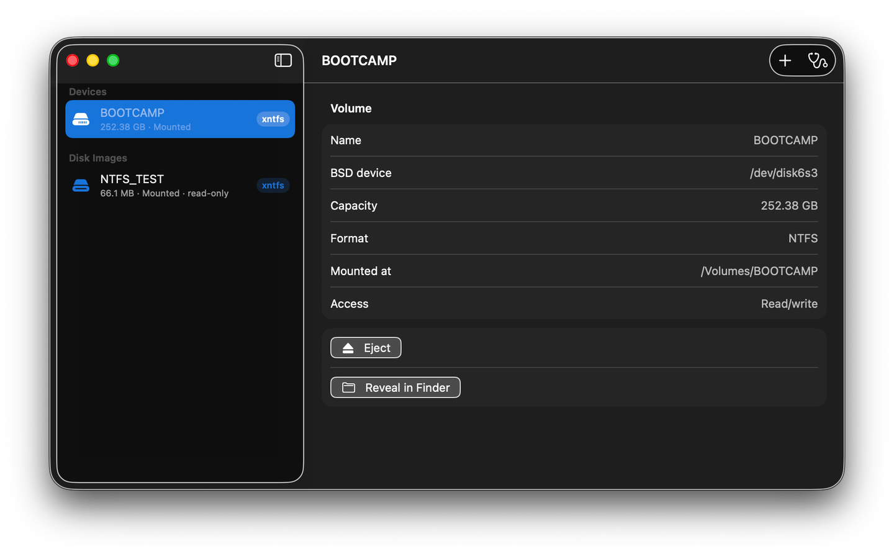

# xntfs - Open-source NTFS read/write for macOS

> Use Windows-formatted drives on your Mac with Apple FSKit and ntfs-3g, without macFUSE or a kernel extension.

## What is xntfs?

xntfs is a simple macOS utility for people who use Windows-formatted NTFS drives with a Mac. It helps you read and write supported NTFS volumes, including external hard drives, SSDs, USB drives, Boot Camp volumes, and NTFS disk images.

When macOS presents an NTFS drive as read-only, xntfs provides a user-space file-system extension based on Apple's FSKit and the open-source ntfs-3g engine. Once the extension is enabled, supported NTFS devices can be mounted by macOS under `/Volumes` and used from Finder like other mounted volumes.

## Why use xntfs?

- **FSKit instead of macFUSE** - xntfs uses Apple's modern FSKit file-system extension model and does not install a kernel extension or depend on macFUSE.
- **Read and write NTFS** - ntfs-3g provides the NTFS file-system engine used by the extension.
- **Automatic mounting** - macOS and Disk Arbitration can detect and mount supported NTFS devices after the extension is enabled.
- **A focused interface** - see drives, disk images, the actual driver in use, read-only state, mount location, and basic actions such as eject and Reveal in Finder.
- **Clear diagnostics** - inspect extension installation, enablement, registration paths, duplicate registrations, and common setup problems.
- **Works across Intel and Apple silicon** - the project builds for `x86_64` and `arm64`.
- **Open source** - the source code, build scripts, tests, privacy policy, and compatibility notes are available in this repository.

## Who is it for?

xntfs is for Mac users who regularly exchange files with Windows computers, use NTFS-formatted USB drives or external disks, run Boot Camp, or need to inspect an NTFS disk image on macOS.

If you are searching for an **NTFS driver for Mac**, **NTFS read/write support on macOS**, an **open-source NTFS utility**, **FSKit NTFS**, or **ntfs-3g on macOS**, this project is designed for that use case.

## Typical workflow

1. Install xntfs and enable `ntfs3g` in macOS System Settings under File System Extensions.
2. Connect an NTFS drive or select an NTFS disk image.
3. Confirm the volume is mounted by `xntfs`, then open it in Finder and work with its files.

The app reports the actual mounted file-system type. If macOS has already mounted the volume with its built-in NTFS driver, xntfs explains that enabling the extension does not change an existing mount and shows the next step for that macOS version.

## macOS support

| macOS | Mounting workflow |
|---|---|
| macOS 15 | The built-in NTFS driver may take priority. xntfs provides a per-volume, copyable Terminal command for the user to run when an xntfs mount is needed. |
| macOS 26 | Supported devices can auto-mount after enablement. Use Disk Utility for manual mounts and image attachment. |
| macOS 27 | Adds in-app mounting through the newer FSKit and Disk Arbitration APIs, including raw single-volume NTFS images. |

The minimum deployment target is macOS 15.4. The exact workflow depends on the macOS version, extension state, device type, and whether the underlying media is writable.

## Scope and limits

- The FSKit extension must be signed, installed, and enabled by the user before macOS can use it.
- A physical medium or disk image attached read-only remains read-only; changing the file-system driver cannot make read-only media writable.
- macOS 27 in-app image mounting currently targets raw, single-volume NTFS images. Partitioned or compressed images should be opened in Disk Utility first.
- xntfs provides a read-only mount preflight. It is not a full filesystem repair or recovery tool.
- Existing AppleDouble `._` metadata is not automatically migrated or deleted. See the Finder metadata notes below before migrating files.

## Finder metadata

The current source stores extended attributes, including Finder tags and resource forks, in same-named NTFS alternate data streams. Existing `._` files are not automatically migrated or deleted. Read the [Finder metadata and migration notes](docs/fskit-feature-alignment.md) before upgrading or migrating data.

## xntfs and commercial NTFS tools

Mac users may also come across commercial products such as [Microsoft NTFS for Mac by Paragon Software](https://www.paragon-software.com/home/ntfs-mac/) and [Microsoft NTFS for Mac by Tuxera](https://ntfsformac.tuxera.com/). xntfs takes a different approach: it is an open-source project built around Apple's FSKit and the ntfs-3g engine. It is independent and is not affiliated with Apple, Microsoft, Paragon Software, Tuxera, or the ntfs-3g maintainers.

## Related project

[xlinuxfs](https://github.com/HuanchuanTech/xlinuxfs) brings read/write support for ext2/3/4, XFS, and Btrfs to macOS through FSKit and the Linux Kernel Library (LKL). xntfs focuses on NTFS; xlinuxfs focuses on Linux file systems. Both projects use FSKit and avoid macFUSE.

## Documentation

- [Architecture and code structure](docs/architecture.md)
- [Build and development](docs/build.md)
- [FSKit feature alignment and validation](docs/fskit-feature-alignment.md)
- [macOS 15 compatibility](docs/macos15-compatibility.md)
- [macOS 27 support](docs/macos27-support.md)
- [Issue #7 validation](docs/issue-7-validation.md)
- [Privacy policy](PRIVACY.md)

## Open source

- [Source code and issues](https://github.com/HuanchuanTech/xntfs)
- [GPLv2 license](LICENSE)

xntfs is an independent project. NTFS is a Microsoft file-system format, and the names Apple, Microsoft, Paragon, Tuxera, and ntfs-3g belong to their respective owners.
