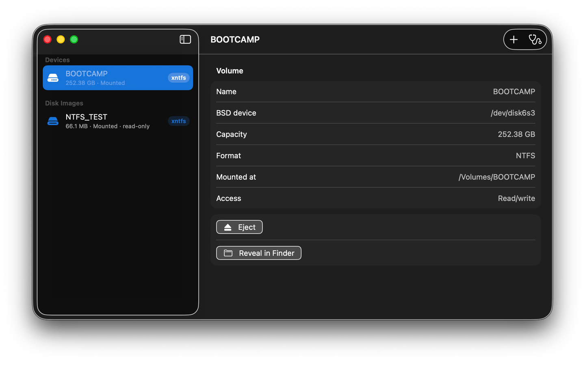

# xntfs - macOS 上的开源 NTFS 读写工具

> 使用 Apple FSKit 和 ntfs-3g 在 Mac 上读写 Windows 格式磁盘，无需 macFUSE，也无需内核扩展。

## xntfs 是什么？

xntfs 是一个简单的 macOS 工具，面向需要在 Mac 上使用 Windows 格式 NTFS 磁盘的用户。它帮助你读写支持的 NTFS 卷，包括外置硬盘、SSD、U 盘、Boot Camp 卷和 NTFS 磁盘映像。

当 macOS 将 NTFS 磁盘以只读方式显示时，xntfs 通过 Apple 的 FSKit 用户态文件系统扩展和开源 ntfs-3g 引擎提供支持。启用扩展后，支持的 NTFS 设备可以由 macOS 挂载到 `/Volumes`，然后像其他磁盘一样在 Finder 中使用。

## xntfs 有什么优势？

- **使用 FSKit，而不是 macFUSE**：xntfs 使用 Apple 的现代 FSKit 文件系统扩展模型，不安装内核扩展，也不依赖 macFUSE。
- **读写 NTFS**：扩展底层使用 ntfs-3g 处理 NTFS 文件系统。
- **支持自动挂载**：启用扩展后，macOS 和 Disk Arbitration 可以识别并挂载支持的 NTFS 设备。
- **界面简单**：查看磁盘、磁盘映像、实际使用的驱动、只读状态、挂载位置，并执行推出和在 Finder 中显示等操作。
- **诊断信息清楚**：检查扩展是否安装、是否启用、注册路径、重复注册和常见配置问题。
- **支持 Intel 和 Apple 芯片**：项目同时构建 `x86_64` 和 `arm64` 版本。
- **开源**：源代码、构建脚本、测试、隐私政策和兼容性说明都在本仓库中。

## 适合哪些用户？

xntfs 适合经常与 Windows 电脑交换文件、使用 NTFS 格式 U 盘或外置硬盘、运行 Boot Camp，或需要在 macOS 上查看 NTFS 磁盘映像的 Mac 用户。

如果你正在搜索“**Mac 读写 NTFS**”“**macOS NTFS 工具**”“**开源 NTFS 工具**”“**FSKit NTFS**”或“**macOS 上的 ntfs-3g**”，这个项目就是为这类需求设计的。

## 基本使用流程

1. 安装 xntfs，并在 macOS「系统设置」的「文件系统扩展」中开启 `ntfs3g`。
2. 插入 NTFS 磁盘，或选择一个 NTFS 磁盘映像。
3. 确认卷使用的是 `xntfs`，然后在 Finder 中打开并操作文件。

应用会显示实际使用的文件系统类型。如果 macOS 已经使用内置 NTFS 驱动挂载了磁盘，xntfs 会说明“开启扩展”不会改变已经存在的挂载，并根据系统版本提示下一步操作。

## macOS 支持情况

| macOS | 挂载方式 |
|---|---|
| macOS 15 | 内置 NTFS 驱动可能优先被选中。需要使用 xntfs 时，应用会提供针对当前卷的可复制终端命令，由用户手动执行。 |
| macOS 26 | 启用扩展后支持的设备可以自动挂载；手动挂载和附加映像使用「磁盘工具」。 |
| macOS 27 | 通过新版 FSKit 和 Disk Arbitration API 支持应用内挂载，也支持原始单卷 NTFS 映像。 |

最低部署版本为 macOS 15.4。具体流程取决于 macOS 版本、扩展状态、设备类型以及底层介质是否可写。

## 支持范围和限制

- FSKit 扩展需要由用户签名、安装并启用，macOS 才能使用它。
- 以只读方式附加的物理介质或磁盘映像仍然只能只读；更换文件系统驱动不能让只读介质变成可写。
- macOS 27 的应用内镜像挂载目前面向原始单卷 NTFS 映像；有分区表或压缩的映像应先使用「磁盘工具」打开。
- xntfs 提供只读的挂载前预检，不是完整的磁盘修复或数据恢复工具。
- 已有的 AppleDouble `._` 元数据不会自动迁移或删除。迁移文件前请先阅读下面的 Finder 元数据说明。

## Finder 元数据

当前源码会把包括 Finder 标签和资源叉在内的扩展属性保存到同名 NTFS 备用数据流中。已有的 `._` 文件不会自动迁移或删除。升级或迁移数据前，请阅读[Finder 元数据和迁移说明](docs/fskit-feature-alignment.md)。

## xntfs 与商业 NTFS 工具

Mac 用户也可能看到 [Microsoft NTFS for Mac by Paragon Software](https://www.paragon-software.com/home/ntfs-mac/) 和 [Microsoft NTFS for Mac by Tuxera](https://ntfsformac.tuxera.com/) 等商业产品。xntfs 采用不同路线：它是一个基于 Apple FSKit 和 ntfs-3g 的开源项目。xntfs 独立开发，与 Apple、Microsoft、Paragon Software、Tuxera 或 ntfs-3g 维护者没有从属关系。

## 关联项目

[xlinuxfs](https://github.com/HuanchuanTech/xlinuxfs) 通过 FSKit 和 Linux Kernel Library（LKL）为 macOS 提供 ext2/3/4、XFS 和 Btrfs 的读写支持。xntfs 专注于 NTFS，xlinuxfs 专注于 Linux 文件系统；两个项目都使用 FSKit，不依赖 macFUSE。

## 文档

- [架构和代码结构](docs/architecture.md)
- [构建和开发](docs/build.md)
- [FSKit 能力对齐与验证](docs/fskit-feature-alignment.md)
- [macOS 15 兼容性](docs/macos15-compatibility.md)
- [macOS 27 支持](docs/macos27-support.md)
- [Issue #7 验证记录](docs/issue-7-validation.md)
- [隐私政策](PRIVACY_CN.md)

## 开源项目

- [源代码和 Issue](https://github.com/HuanchuanTech/xntfs)
- [GPLv2 许可证](LICENSE)

xntfs 是独立项目。NTFS 是 Microsoft 的文件系统格式，Apple、Microsoft、Paragon、Tuxera 和 ntfs-3g 等名称归其各自所有者所有。
